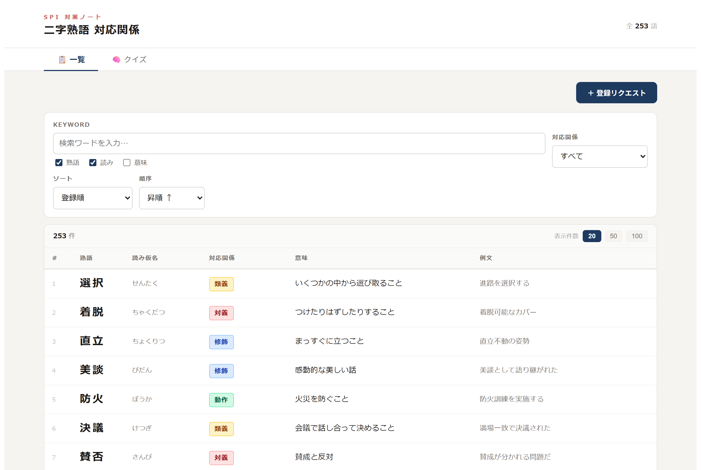
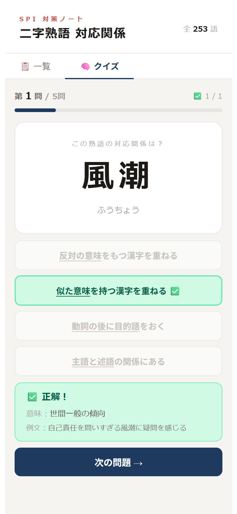
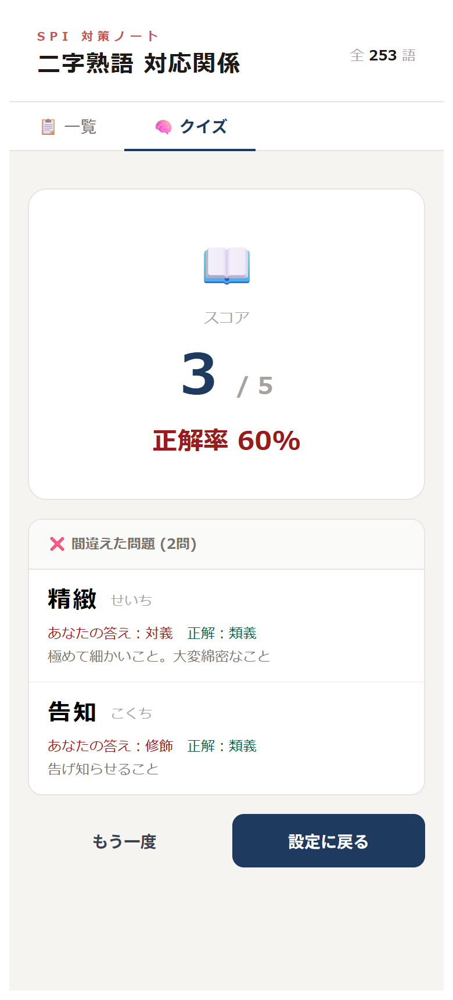

# SPI熟語学習 — 二字熟語 対応関係

SPI 対策向けの「二字熟語の対応関係」に特化した熟語辞典 Web アプリです。
熟語を表形式で一覧・検索でき、4 択クイズで学習もできます。

**🔗 デモ: https://spi-vocab-dictionary.vercel.app**



| クイズ（回答直後） | クイズ（結果） |
|:---:|:---:|
|  |  |

## 背景

SPI の言語分野には、二字熟語を構成する 2 つの漢字の関係を見分ける問題があります。対策のために熟語を調べようとしても、一般的な国語辞典はこの「対応関係」の観点でまとまっていません。そこで、次の 3 つを目標に作りました。

1. **SPI 対策に特化した熟語辞典をつくる** — 熟語ごとに対応関係・意味・例文を整理する
2. **表形式でさっと見られるようにする** — 一覧・検索・絞り込みで目的の熟語にすぐたどり着ける
3. **ついでにクイズで学習できるようにする** — 登録した熟語がそのまま 4 択問題になる

対応関係は次の 5 種類で分類しています（どれにも当てはまらない熟語は「その他」として登録でき、クイズの出題対象からは外しています）。

| 種類 | 説明 | 例 |
|------|------|----|
| 類義 | 似た意味の漢字を重ねる | 選択 |
| 対義 | 反対の意味の漢字を重ねる | 売買 |
| 修飾 | 前の漢字が後の漢字を修飾する | 温泉 |
| 動作 | 動詞の後に目的語をおく | 読書 |
| 主述 | 主語と述語の関係にある | 地震 |

データはクラウドに保存しているため、PC で登録した熟語をスマホでそのまま確認・学習できます。

## 主な機能

### 誰でも使える機能
- **一覧・検索**：熟語 / 読み / 意味を対象に検索、対応関係で絞り込み、ソート、ページネーション
- **クイズモード**：5 / 10 / 20 問から選んで 4 択で回答。即時に正誤と意味・例文を表示し、最後に正解率と間違えた問題を一覧表示
- **登録リクエスト**：熟語の追加を申請できる（管理者の承認後に反映）
- **レスポンシブ対応**：スマホでもクイズが 1 画面に収まるよう調整

### 管理者向け機能（専用 URL からログイン）
- **熟語の登録・編集・削除**（入力中に重複をリアルタイム警告）
- **リクエスト承認**：未処理 / 承認済 / 却下済のタブ表示、個別・選択・全件の一括承認 / 却下、承認の取り消し
- **バックアップ**：JSON / CSV でエクスポート、インポート（既存と重複する熟語は自動スキップ）

## 技術スタック

| 層 | 技術 |
|----|------|
| フロントエンド | React 18 / Vite 5 |
| データベース | Supabase（PostgreSQL） |
| 認証 | Supabase Auth（メール＋パスワード） |
| ホスティング | Vercel（`main` への push で自動デプロイ） |

### 構成

```
ブラウザ (React SPA)
   │  supabase-js（anon key）
   ▼
Supabase ── PostgreSQL（words / word_requests）
         └─ Auth（管理者ログイン）
         └─ RLS（行レベルセキュリティで書き込み権限を制御）
```

サーバーサイドのコードは持たず、権限制御はすべて Supabase の RLS で行っています。

## 設計で工夫した点

### 1. 画面の出し分けではなく、DB 側で権限を守る
フロントエンドで編集ボタンを隠すだけでは、anon key を使って API を直接叩けば書き換えができてしまいます。そこで RLS を有効にし、**DB 側で権限を強制**しました。画面の出し分けは見た目を整えるためのもので、守りの本体は RLS です。

| テーブル | 読み取り | 書き込み |
|----------|----------|----------|
| `words` | 全員 | ログイン済み（管理者）のみ |
| `word_requests` | 管理者のみ | insert は全員 / update・delete は管理者のみ |

### 2. 「申請 → 承認」でデータの質を保つ
一般ユーザーにも熟語を集めてもらいたい一方、誤ったデータが直接入るのは避けたい。そこで申請を別テーブル `word_requests` に分け、管理者が承認したものだけを `words` に移す流れにしました。

- 承認時に重複していれば `words` には追加せず、承認済みとしてだけ記録
- 承認で作られた `words` の ID を `approved_word_id` に保存し、**「未処理に戻す」操作で追加した熟語も確実に取り消せる**ようにした

### 3. 失敗を握りつぶさない
当初は Supabase の戻り値の `error` を確認せず、成功したものとして画面を更新していたため、通信に失敗しても画面上は成功したように見えていました。全操作で `error` を確認し、失敗時はフォームを閉じない・一覧上部に通知を出す・一括処理では失敗件数を表示するように改めました。

### 4. 入力値の検証を全経路で揃える
熟語は 2 文字以上、読み仮名はひらがなのみ、というルールを **管理者登録・一般申請・CSV/JSON インポートのすべて** に同じように適用しています。インポートではエラーになった行の番号と理由を一覧で表示します。

## データ構造

<details>
<summary><code>words</code>（登録済みの熟語）</summary>

| カラム | 型 | 備考 |
|--------|----|------|
| id | bigint | 主キー |
| jukugo | text | 熟語 |
| yomi | text | 読み仮名 |
| relation | text | 類義 / 対義 / 修飾 / 動作 / 主述 / その他 |
| meaning | text | 意味 |
| example | text | 例文（任意） |
| created_at | timestamptz | 登録日時 |

</details>

<details>
<summary><code>word_requests</code>（一般ユーザーからの申請）</summary>

| カラム | 型 | 備考 |
|--------|----|------|
| id | bigint | 主キー |
| jukugo / yomi / relation | text | 申請時に必須 |
| meaning / example | text | 任意 |
| status | text | `pending` / `approved` / `rejected` |
| created_at | timestamptz | 申請日時 |
| reviewed_at | timestamptz | 承認・却下日時 |
| approved_word_id | bigint | 承認時に作成した `words.id`（取り消し時は null に戻す） |

</details>

## ローカルで動かす

```bash
git clone https://github.com/fujita-keigo/spi-vocab-dictionary.git
cd spi-vocab-dictionary
npm install
```

プロジェクト直下に `.env` を作成し、Supabase プロジェクトの値を設定します。

```
VITE_SUPABASE_URL=https://xxxxxxxx.supabase.co
VITE_SUPABASE_ANON_KEY=your-anon-key
```

```bash
npm run dev
```

> Supabase 側に上記 2 テーブルの作成と RLS ポリシーの設定、管理者ユーザーの作成が必要です。

## 今後の課題

開発中に洗い出した課題のうち、未対応のものです。

- **スパム対策**：申請は誰でも送れるため、公開範囲を広げる前にレート制限や CAPTCHA を導入する
- **文字数上限**：申請の意味・例文に上限がなく、極端に長いデータを送れてしまう
- **CSV インジェクション対策**：`=` などで始まる値を Excel で開くと数式として実行され得る
- **クイズのシャッフル**：`sort(() => Math.random() - 0.5)` は偏りがあるため Fisher–Yates に置き換える
- **コードの分割**：`App.jsx` 1 ファイルに集約しているため、画面ごとにコンポーネントを分ける
- **テスト**：バリデーションや CSV パーサーなどのロジックにユニットテストを追加する

## 開発期間

2026 年 6 月（約 1 か月、個人開発）

## 注意事項

- 「SPI」は株式会社リクルートマネジメントソリューションズが提供する適性検査の名称です。本アプリは個人が作成した非公式の学習ツールであり、同社とは一切関係がなく、同社が提供・承認するものではありません。
- 本アプリは受検前の自主学習を目的としています。実際の検査問題を再現・掲載するものではありません。
- 収録している熟語・意味・例文は、生成 AI を用いて作成したものです。実際の検査問題や市販教材からの転載ではありません。内容に誤りが含まれる可能性があります。
- 受検中に本アプリを参照するなど、各検査の受検ルールに反する目的での利用は想定していません。
